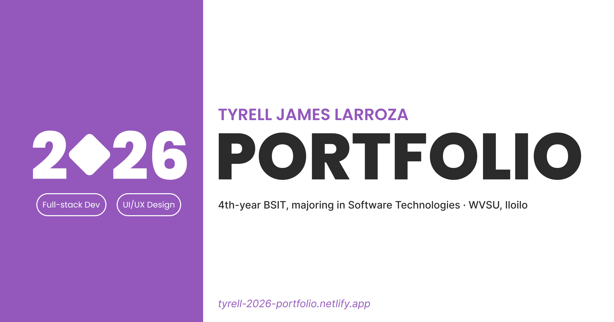

<p align="center">
  
</p>

<p align="center">
  <a href="https://tyrell-2026-portfolio.netlify.app"></a>
  &nbsp;
  <a href="https://www.linkedin.com/in/tyrell-james-larroza"></a>
</p>

<p align="center">
  
  
  
  
  
  
  
  
</p>


## About
Hi! I'm Tyrell James A. Larroza from Iloilo City, Philippines. I'm a 4th-year BSIT student majoring in Software Technologies at West Visayas State University with a strong academic foundation in full-stack development, UI/UX design, and project management. I mainly use Visual Studio Code, Figma, Draw.io, Canva, Google Workspace, and GitHub.

## Highlights
- Fully responsive (desktop / tablet / phone), designed in Figma first
- Swipeable, looping carousel built from scratch (no carousel library)
- Page-load and page-transition animations, custom cursor
- Respects reduced-motion settings
- Smooth scrolling with Lenis

## Running Locally
```
npm install
npm run dev       # dev server
npm run build     # production build
npm run preview   # preview the build
```

## Project Structure
```
src/
├── assets/             # Images, Logos
├── components/
│	├── layout/     # Navbar, Cursor, Contact
│	└── ui/         # Buttons, Chips, Carousels
├── pages/              # Home, Projects, About, Experiences
└── data/               # Site content
```

## Credits
Fonts, icons, photo credits (e.g. the LINK.exe event photos, NYATS photos), anything borrowed.